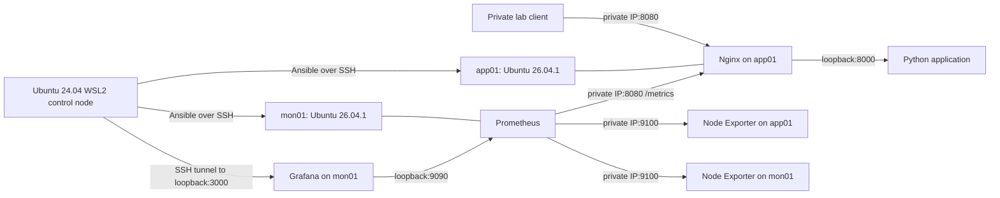
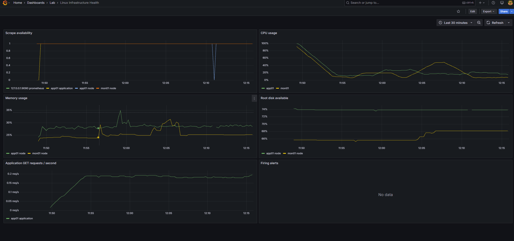

# Linux Infrastructure Automation

A Junior DevOps portfolio lab that configures two Ubuntu servers with Ansible,
deploys a containerized Python service behind Nginx, and monitors host/application
health with Prometheus and Grafana. The application is deliberately small so the
project focuses on Linux administration, automation, observability and recovery.

**Lab status:** the operator confirms successful Ansible deployment on both VMs,
a passing application smoke test, and alert detection/recovery when Node Exporter
on app01 was stopped and restarted. [Four original screenshots](docs/screenshots/README.md)
now show the firing/resolved alert, Grafana metrics and four healthy Prometheus
targets. Deployment logs and measured recovery times are not included.
See [validation and evidence](docs/validation.md) for the exact boundary of each claim.

## Architecture



The lab uses app01 at `192.168.56.104` and mon01 at `192.168.56.105`. These are
private lab addresses; Ansible reads deployment addresses and SSH users from the
ignored local inventory rather than hardcoding them into service configuration.
Both VMs need outbound package/image access and private VM-to-VM connectivity.
See [architecture, ports and design decisions](docs/architecture.md).

## Technologies and responsibilities

| Area | Implementation |
|---|---|
| Linux | Ubuntu Server, SSH keys, sudo, systemd, logs and APT |
| Automation | Ansible inventories, roles, variables, handlers and verification |
| Application | Standard-library Python HTTP service; `/health`, `/metrics`, JSON logs |
| Containers | Docker Engine/Compose, non-root app/proxy, health checks, restart policies |
| Networking | Nginx reverse proxy, private listeners and SSH tunnels |
| Monitoring | Native Node Exporter on both hosts; Prometheus; provisioned Grafana datasource/dashboard |
| Alerting | Target unavailability, CPU/memory pressure and low root-filesystem space |
| CI | GitHub Actions, configuration checks, unit/alert tests and ephemeral container integration |

## Repository layout

```text
ansible/                 playbooks, roles, inventory examples and local fixture tests
app/                     demo application, Dockerfile and HTTP tests
docker/                  separate application/monitoring Compose stacks
monitoring/              scrape configuration, alert rules/tests, Grafana provisioning
.github/workflows/       CI checks; no connection to the private VMs
scripts/                 smoke, target, idempotency, recovery and publication checks
tests/                   secret-guard regression tests
docs/                    deployment, troubleshooting, recovery and evidence
docs/screenshots/        four original alert/recovery/dashboard/target screenshots
requirements-control.txt pinned control-node Python dependencies
```

## Setup and deployment

For a new lab, prepare Ubuntu Server 26.04 VMs with approximately 2 vCPU/2 GB RAM/
25 GB disk for app01 and 2 vCPU/3 GB RAM/30 GB disk for mon01. Use a shared private
VirtualBox network and outbound NAT, stable addresses, and an existing non-root
sudo account with working key-based SSH from WSL. Verify WSL routing explicitly.
Keep private keys outside the repository. [Full setup instructions](docs/deployment.md)
cover VirtualBox networking, SSH, inventory and encrypted secrets.

From the repository root:

```bash
python3 -m venv .venv
source .venv/bin/activate
python -m pip install -r requirements-control.txt
ansible-galaxy collection install -r ansible/requirements.yml
# New checkout only: copy the sanitized example without overwriting a working lab.
cp -n ansible/inventory/lab.example.ini ansible/inventory/lab.ini
```

Edit the local inventory with your actual SSH users/IPs. If venv support is missing,
install `python3-venv` only after approving that system change. Create an encrypted
`ansible/inventory/group_vars/all/secrets.yml` with your own generated
`grafana_admin_password`; see the deployment guide. Do not copy a demonstration
password into the real lab or publish the Vault file/password.

After approving package installation and deployment, from `ansible/`:

```bash
ansible-playbook -i inventory/lab.ini playbooks/preflight.yml --ask-vault-pass
ansible-playbook -i inventory/lab.ini playbooks/setup.yml --limit app01 --ask-become-pass --ask-vault-pass
ansible-playbook -i inventory/lab.ini playbooks/setup.yml --limit mon01 --ask-become-pass --ask-vault-pass
```

Separate host runs allow different sudo passwords. Setup installs prerequisites
and deploys/verifies each stack. Later source/configuration updates use
`playbooks/deploy.yml`. Source changes trigger an application rebuild; relevant
configuration changes trigger service handlers. Repeatability is implemented;
whole-lab zero-change idempotency still needs a recorded lab result.

The common role comments the dedicated installer `cdrom.sources` file before
APT updates, avoiding attempts to use missing installation media. This new
repair has a local idempotency regression test; it has not been applied to either
VM during repository finalization. See [the APT explanation](docs/apt-installation-media.md).

SSH authentication and UFW policy are not edited by setup/deploy. The firewall
playbook is separate, requires explicit approval and refuses to run without its
opt-in variable. Docker itself creates its standard daemon networking.

## Monitoring and verification

Prometheus scrapes both host exporters, application metrics through Nginx, and
itself. Grafana provisions CPU, memory, root disk, availability, application
request-rate and alert panels. Configuration provisioning is implemented;
standalone dashboard/API verification evidence is not included yet.

Grafana and Prometheus bind loopback on mon01. With the SSH user/IP/key from your
local inventory, open a tunnel:

```bash
ssh -N -o ExitOnForwardFailure=yes \
  -L 3000:127.0.0.1:3000 -L 9090:127.0.0.1:9090 MON_USER@MON_IP
```

Open `http://localhost:3000` (Grafana, user `admin`, your vaulted password),
`http://localhost:9090/targets` and `/alerts`. With the tunnel open, from the
repository root:

```bash
scripts/smoke-test.sh http://192.168.56.104:8080
scripts/verify-server.sh --ask-vault-pass
python3 scripts/check-targets.py
```

These commands contact the real lab; none were rerun during publication review.

## Monitoring evidence



| Capture | Evidence |
|---|---|
| [Firing alert](docs/screenshots/01-alert-firing.png) | `TargetUnavailable`, `node/app01`, FIRING, value 0 |
| [Recovery](docs/screenshots/02-alert-recovered.png) | TargetUnavailable inactive after the reported restart |
| [Grafana](docs/screenshots/03-grafana-dashboard.png) | Provisioned infrastructure dashboard populated with metrics |
| [Prometheus](docs/screenshots/04-prometheus-targets.png) | Application, both host exporters and Prometheus all UP |

See the [full gallery and evidence limits](docs/screenshots/README.md).

## Reliability and troubleshooting

The confirmed Node Exporter stop/start experiment demonstrated alert detection
and service recovery. The [recovery record](docs/node-exporter-recovery.md)
links the captured FIRING and subsequent inactive states and separates these
observations from a future repeatable procedure. Exact recovery duration remains
unmeasured.

[Additional experiments](docs/failure-testing.md) cover application crashes,
VM shutdown, bad configuration, clean rebuilds and idempotency. They remain
planned unless explicitly marked otherwise. Disruptive actions and configuration
runs require approval; a health check alone does not restart an unhealthy container.

For approved idempotency checks:

```bash
scripts/idempotency.sh --limit app01 --ask-become-pass --ask-vault-pass
scripts/idempotency.sh --limit mon01 --ask-become-pass --ask-vault-pass
```

Use [troubleshooting](docs/troubleshooting.md) to distinguish SSH/routing failures,
APT installation-media errors, Docker startup, proxy 502 responses, failed
scrapes, Vault errors and tunnel problems. Capture logs before changing settings.

## CI and safe local checks

GitHub Actions runs on push, pull request and manual dispatch with read-only
repository permissions. Static checks and local Ansible fixtures run before a
separate container job. The latter validates Compose/Prometheus, tests alerts,
builds the image and checks proxy, scraping and Grafana provisioning. It never
SSHs to or deploys on the private VMs. [CI details](docs/ci.md).

```bash
python -m unittest discover -s app -v
python -m unittest discover -s tests -v
python scripts/validate.py
python scripts/check-publication.py
for script in scripts/*.sh; do bash -n "$script"; done
```

The [validation record](docs/validation.md) reports executed local checks and
checks blocked by missing Docker integration. No CI badge claims a passing run
without checking the actual workflow result. The [screenshot gallery](docs/screenshots/README.md)
contains four original captures with explanations of what each demonstrates.

## Security and limitations

- Private-network HTTP only; monitoring UIs use SSH tunnels. No public ingress or TLS automation.
- UFW enforcement and further SSH hardening require separate approval; neither is claimed as tested.
- Host networking simplifies this small Linux lab but reduces container network isolation.
- Each VM is a single point of failure. Prometheus cannot report its own VM's outage while down.
- Alert rules have no external notification delivery; there is no high availability or automatic rollback.
- Container restart policies do not replace backup/recovery procedures. Named volumes retain data,
  but historical metrics/Grafana database backups are not implemented.
- Image tags are baseline versions, not immutable digests; OS packages are not version-locked.
  Review support/security updates before production use. The demo HTTP server is a lab workload.
- Local inventory, Vault files, passwords, keys, `.env` files, logs and `.venv` stay outside Git.
  The publication scanner is a heuristic and still requires manual staged review.

See [security boundaries](docs/security.md) and [publication instructions](docs/publication.md).
No push, remote change, commit or additional VM operation is automated.
