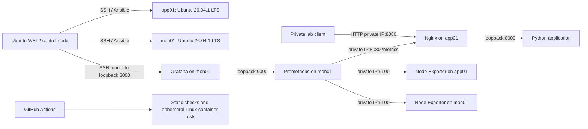

# Architecture and decisions

## Service boundaries

Both VMs have a private, stable IPv4 address and outbound Internet access for
APT and image downloads. `ansible_host` is the SSH destination; `private_ip` is
an address actually assigned to the VM and reachable by the other VM.
The existing inventory is the source of deployment addresses. Private lab
addresses in documentation describe the operator-confirmed topology only.

All Compose services use **Linux host networking**. This deliberately simplifies
routing in a two-host lab. There are no Docker-published ports and no Docker
socket mounts. UFW therefore governs incoming host connections, including Nginx
and Node Exporter. Host networking reduces container network isolation and
requires dedicated ports; do not run these stacks on shared production hosts.

| Host | Bind | Purpose | Expected caller |
|---|---|---|---|
| app01 | 127.0.0.1:8000 | Python HTTP | Nginx |
| app01 | private_ip:8080 | Proxy, /health, /metrics | Private clients, control node, Prometheus |
| app01 | 127.0.0.1:8081 | Proxy health probe | Local checks |
| both | private_ip:9100 | Native Node Exporter | mon01 |
| mon01 | 127.0.0.1:9090 | Prometheus UI/API | Grafana, SSH tunnel |
| mon01 | 127.0.0.1:3000 | Grafana UI/API | SSH tunnel |
| both | SSH port, initially 22 | Administration | Approved admin source |

Node Exporter is installed from Ubuntu packages as a systemd service. This
reports the real host without a container root-filesystem mount. Application,
Nginx, Prometheus and Grafana are managed by Compose. Docker starts at boot;
`unless-stopped` restarts containers after process failure or daemon reboot,
unless they were deliberately stopped. An unhealthy container is not
necessarily restarted. A health check is a signal, not a recovery controller.

## Configuration flow

`preflight.yml` checks OS/network facts without sudo. `setup.yml` installs prerequisites, then imports `deploy.yml` and `verify.yml`.
`deploy.yml` updates source/configuration and reconciles both Compose projects.
Application source changes trigger a rebuild. Bind-mounted Nginx/Prometheus
configuration changes trigger service recreation/restart. Normal repeat runs
should report `changed=0`; verify this on actual VMs using the idempotency script.

`firewall.yml` is separate and defaults to refusing execution. SSH configuration
is never changed. The existing administrative accounts and SSH identity are preserved; later
access-policy changes require separate approval.

The application is built on app01 from the copied repository source. CI builds
the same Dockerfile as a check; it does not publish or deliver an image. This
avoids adding a registry or registry credentials to the first release.

## Availability and storage

Prometheus checks metric scraping through Nginx, so a failed proxy or application
produces a failed application target. `/health` is separately checked by smoke
tests. No external HTTP blackbox probe or alert notification service is included.
Firing alerts are visible in Prometheus; Grafana shows their series.

Prometheus and Grafana use named volumes. Prometheus retains at most seven days
or its configured 2 GB retention size (allow extra disk for WAL and overhead).
Compose redeployment preserves volumes. A clean rebuild restores configuration
and dashboards, not historical metrics or manually changed Grafana state.
Both hosts are single points of failure; this project demonstrates detection
and recovery, not high availability.

## Inventory contract and OS support

Use `app_servers` and `monitoring_servers` from the preserved local inventory.
Ansible derives `private_ip` from `ansible_host` unless explicitly overridden.
The SSH users remain host-specific. Preflight accepts Ubuntu 24.04 and 26.04
including point releases, and verifies the selected private address is actually
assigned to the host. Ubuntu 26.04 deployments require Ansible core 2.20+ for
target Python 3.14 support. The Docker APT source uses the discovered codename
and architecture, never Ubuntu 24.04 packages on a 26.04 host.
