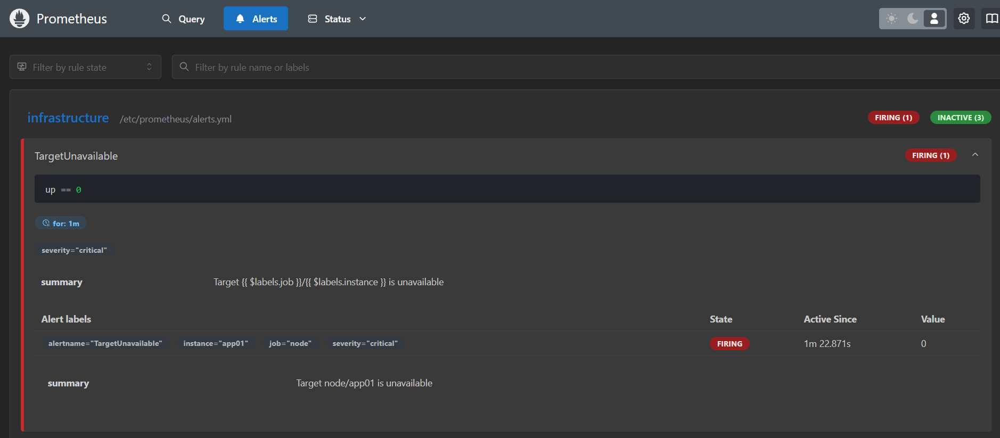
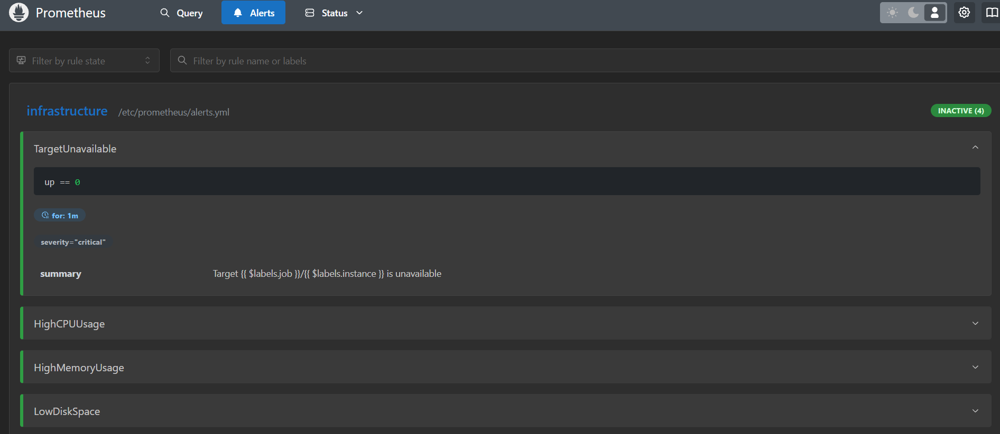
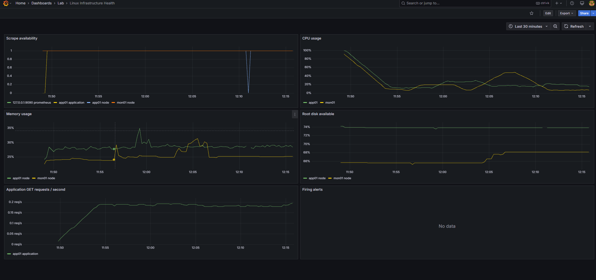
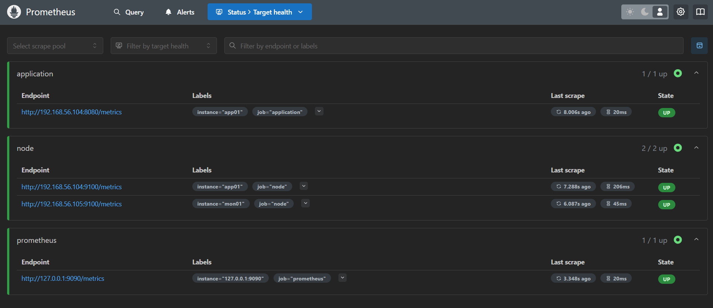

# Monitoring and recovery evidence

Four original screenshots supplied by the project operator on 2026-11-08.
They are stored without image editing and in the operator-specified order.
Visual review found no visible passwords, private keys or tokens. The target
addresses shown are the private lab endpoints already documented in the project.

## 1. Firing alert

Prometheus shows `TargetUnavailable` in **FIRING** state with `instance="app01"`,
`job="node"`, `severity="critical"`, and value `0`. The rule uses `up == 0`
with a one-minute pending period. This captures detection of the unavailable
Node Exporter target; it does not mean the application or whole VM was down.

## 2. Recovery after the incident

The operator identifies this as the post-recovery capture. `TargetUnavailable`
is inactive, and the infrastructure group shows **INACTIVE (4)**. Together with
the firing capture and reported exporter restart, this documents detection and
resolution. The screenshots do not establish an exact recovery duration.

## 3. Grafana dashboard

The **Lab → Linux Infrastructure Health** dashboard displays scrape availability,
CPU, memory, root-disk availability and application request-rate data. The
availability plot includes a brief app01 node-target dip. The firing-alerts panel
shows “No data” in this capture; no external notification delivery is claimed.

## 4. Prometheus target health

All four configured targets are **UP** at capture time:

- Application: `192.168.56.104:8080/metrics`.
- app01 Node Exporter: `192.168.56.104:9100/metrics`.
- mon01 Node Exporter: `192.168.56.105:9100/metrics`.
- Prometheus itself: `127.0.0.1:9090/metrics`.

These captures support the [Node Exporter recovery record](../node-exporter-recovery.md).
They do not replace deployment logs, a measured incident timeline, whole-lab
idempotency results, VM reboot tests or proof of continuous availability.
